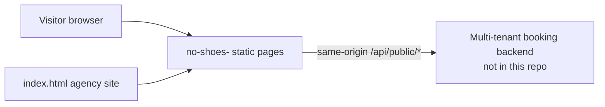

# no-shoes-

Seven self-contained static web pages for "No Shoes Media Marketing" and its Gulf Coast clients, with photos embedded in each file.

## What it is

An agency portfolio: the agency's own homepage plus link-in-bio style pages for local businesses (boat rentals, fishing charters, a restaurant and an influencer). The pages are finished-looking front ends only; the booking backend they call is not in this repo.

## How it works

- Seven plain HTML files, no `package.json` and no server code. Images are base64 `data:` URIs inside the files, so the repo is large (about 6 MB) for its size.
- `index.html`: agency homepage ("No Shoes Media Marketing"); `noshoes-media.html` is a near-identical second version.
- Client pages: `beachside-site.html` (Beachside Circle Boats), `charter-fishing.html` (Bottomed Out Fishing Charters; a near-copy of the Beachside page), `galley-restaurant.html` (The Galley on the River), `kraken-reels.html` (Kraken Reels Charter Services), `beachbilly-influencer.html` (Beachbilly Lifestyle).
- Client pages set `API_BASE = window.location.origin` and a `SUBDOMAIN` tenant constant (Beachbilly reads `?subdomain=`), then call `/api/public/bookings`, `/api/public/reservations` (Galley), `/api/public/referrals` and `/api/public/merch-orders` (Beachbilly) and read profile, fleet, reviews and availability data.
- Those routes must be provided by whatever server hosts the pages; none are defined here.

## Run it

```sh
python3 -m http.server 8000     # then open http://localhost:8000/index.html
```

No install and no environment variables. Pages display as static files; booking, reservation, review and availability calls fail unless the pages are served behind a matching multi-tenant API.

## Status

Asset dump: finished client pages with embedded images, dependent on a backend that lives elsewhere.

## Where it fits



## Related repos

- The booking-platform and dashboard repos that implement the multi-tenant `/api/public/*` endpoints (not identified in this repo).
- booking-: an empty repo with a booking-related name; nothing links it to these pages.
